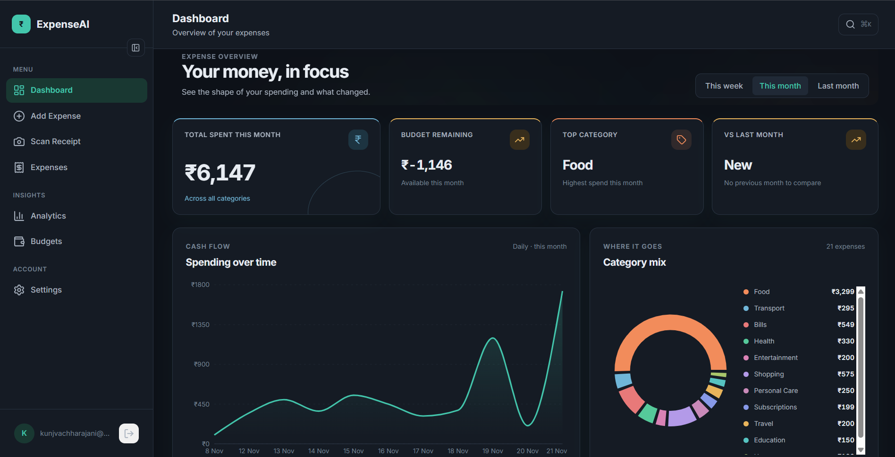
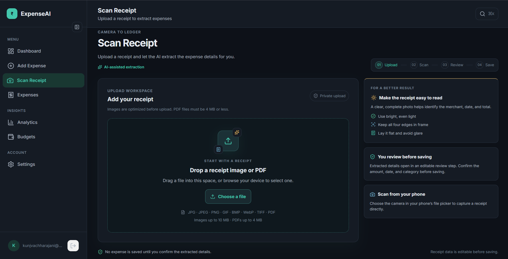

# AI Receipt & Expense Tracker

[](https://github.com/kunjvachharajani/Ai-Expense-Tracker/actions/workflows/ci.yml)
[](https://ai-expense-tracker-peach-kappa.vercel.app)
[](https://github.com/kunjvachharajani/Ai-Expense-Tracker)

**Live Demo (Production):** [https://ai-expense-tracker-peach-kappa.vercel.app](https://ai-expense-tracker-peach-kappa.vercel.app)

A personal expense tracker with a FastAPI API, React frontend, receipt scanning, analytics, budgets, and spending insights.

## Screenshots

<!-- Add the real screenshots at these paths. -->






## Features

- Add expenses manually or parse a natural-language description into a draft.
- Scan receipt images and PDFs, review the extracted draft, then confirm before saving.
- View dashboard summaries, recent expenses, category and date analytics, and budgets.
- See spending insights for category spikes, new merchants, duplicate charges, recurring-charge drift, and budget pace. Deterministic Python detectors calculate the facts and figures; the Groq-hosted LLM only rewrites those facts as plain sentences, so it does not generate the numbers.
- Sign in and create accounts through Supabase Auth.

## Architecture

The React frontend calls the FastAPI backend. The backend reads and writes expense data in Supabase PostgreSQL, verifies Supabase JWTs on protected routes, and calls Groq and OCR.space when parsing expenses or receipts. `api/index.py` exposes the FastAPI app as a Vercel serverless function; `vercel.json` also configures the frontend build and routes.

## Tech Stack

| Layer | Technology |
|---|---|
| Frontend | React 19, Vite, React Router, Recharts |
| Backend | Python, FastAPI, Pydantic |
| Language and vision models | Groq-hosted LLM; configured with `GROQ_MODEL` and `GROQ_VISION_MODEL` |
| Receipt OCR | Groq Vision and OCR.space |
| Database and authentication | Supabase PostgreSQL and Supabase Auth |
| PDF text extraction | PyMuPDF |

## AI Pipeline

- **Images:** try Groq Vision first (`GROQ_VISION_MODEL`). If that does not return an extraction, try OCR.space and parse its text with the Groq LLM. If automatic extraction fails, the API returns a draft for manual entry.
- **PDFs:** try direct embedded-text extraction with PyMuPDF first. If the PDF has no usable embedded text, the OCR service tries OCR.space; the extracted text is parsed by the Groq LLM. If PDF text extraction/parsing fails, the route can fall back to Groq Vision.
- **Natural language:** the Groq LLM parses the text into a validated expense draft.
- **Spending insights:** Python detectors calculate each fact; the Groq LLM turns those facts into short messages. Extracted drafts are shown for review and require user confirmation before saving.

## Folder Structure

```text
.
├── api/
│   └── index.py                 # Vercel serverless entry point
├── backend/
│   ├── app/
│   │   ├── api/                 # Auth, expenses, receipts, analytics, budgets
│   │   ├── services/            # OCR, Groq, analytics, spending insights
│   │   ├── categories.py
│   │   ├── config.py
│   │   ├── db.py
│   │   ├── dates.py
│   │   ├── main.py
│   │   └── schemas.py
│   ├── tests/
│   ├── conftest.py
│   └── database_setup.sql
├── frontend/
│   └── src/
│       ├── components/
│       ├── hooks/
│       ├── pages/
│       └── services/
├── .github/workflows/ci.yml
├── requirements.txt             # Python dependencies for the repo
├── vercel.json
└── README.md
```

## Setup Instructions

### Prerequisites

- Python 3.10 or newer
- Node.js and npm
- Supabase project
- Groq API key for LLM and Vision features
- OCR.space API key for OCR fallback

### 1. Configure Supabase

Create a Supabase project and run `backend/database_setup.sql` in the Supabase SQL Editor. Set the project URL, anon key, and service-role key in your local backend environment. Enable email/password authentication if you want to use the included sign-up and sign-in pages.

### 2. Install and run the backend

From the repository root:

```bash
python -m venv .venv
# Windows PowerShell:
.\.venv\Scripts\Activate.ps1
# macOS/Linux:
# source .venv/bin/activate
python -m pip install -r requirements.txt
```

Create `backend/.env` using `backend/.env.example` as a reference. Configure `SUPABASE_URL`, `SUPABASE_ANON_KEY`, `SUPABASE_SERVICE_ROLE_KEY`, `GROQ_API_KEY`, `OCR_SPACE_API_KEY`, and optionally `GROQ_MODEL`, `GROQ_VISION_MODEL`, and `FRONTEND_URL`.

```bash
cd backend
python -m uvicorn app.main:app --reload --port 8001
```

### 3. Install and run the frontend

In another terminal, from the repository root:

```bash
cd frontend
npm install
```

Set `VITE_SUPABASE_URL` and `VITE_SUPABASE_ANON_KEY` in `frontend/.env`. Set `VITE_API_URL=http://localhost:8001` for local backend use, then run:

```bash
npm run dev
```

## API Endpoints

The API exposes 20 routes:

| Area | Routes |
|---|---|
| General | `GET /`, `GET /api/health`, `GET /api/categories` |
| Expenses | `POST /api/expenses/parse-text`, `POST /api/expenses`, `GET /api/expenses`, `GET /api/expenses/{id}`, `PUT /api/expenses/{id}`, `DELETE /api/expenses/{id}` |
| Receipts | `POST /api/receipts/scan` |
| Analytics | `GET /api/analytics/summary`, `GET /api/analytics/recent`, `GET /api/analytics/dashboard`, `GET /api/analytics/ai-summary`, `GET /api/analytics/insights`, `POST /api/analytics/insights/{key:path}/dismiss` |
| Budgets | `GET /api/budgets`, `POST /api/budgets`, `PUT /api/budgets/{id}`, `DELETE /api/budgets/{id}` |

All routes except `/`, `/api/health`, and `/api/categories` require a valid Supabase JWT in `Authorization: Bearer <token>`.

## Database Schema

`backend/database_setup.sql` creates the `expenses`, `budgets`, and `insight_dismissals` tables. Each has a `user_id`; Row Level Security policies limit access to rows belonging to the authenticated user.

## Testing

From the repository root, install the Python dependencies and run:

```bash
python -m pip install -r requirements.txt
cd backend
python -m pytest tests -q
```

The test suite passes without `.env` files, API keys, or external API calls. GitHub Actions runs the same test command on pushes and pull requests to `main`.

## Security

- Protected API routes verify the Supabase JWT and use the authenticated user's ID when querying user-owned records.
- Row Level Security policies in `backend/database_setup.sql` scope expenses, budgets, and insight dismissals to their owner.
- Keep credentials in environment variables or local `.env` files. `.env` is ignored by Git; do not commit secrets.

## Troubleshooting

- For API import errors, run Uvicorn from the `backend/` directory.
- For CORS errors in local development, set `FRONTEND_URL` to the frontend origin.
- If automatic receipt extraction is incomplete, review the draft and enter or correct its fields before saving.

## Deployment

The Vercel configuration builds the frontend and routes `/api/*` to `api/index.py`. Configure the required Supabase and Groq/OCR environment variables in the Vercel project settings. `GROQ_MODEL` and `GROQ_VISION_MODEL` select the text and vision models; `VITE_SUPABASE_URL`, `VITE_SUPABASE_ANON_KEY`, and optionally `VITE_API_URL` configure the frontend.

## License

MIT. See [LICENSE](LICENSE).
